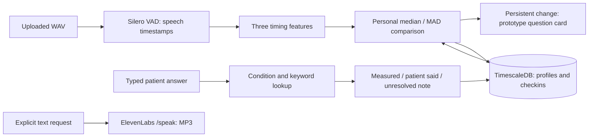

# Cadence: current architecture and research roadmap

Status: documentation/design review of `origin/main` at `45f43f0`, November 8,
2026. This document proposes future work; it adds no runtime features or API
routes. The [README](../README.md) is the current setup/status entry point.
Earlier VoiceShift/CareCircle names and paths remain compatible.

## Current system: Sense → Understand → Act

The standalone HTML dashboard is not connected to this flow. Its fictional
conversations and charts, local playback, and optional host-provided Claude
summaries are a separate prototype. Transcript wording cannot supply measured
acoustic timing, loudness, breathiness, or oxygen values.

| Layer | What the reviewed code does | Current boundary |
| --- | --- | --- |
| Capture | HTTP WAV/WAVEX upload, format/size checks, temporary audio cleanup | No browser recorder, speech-to-text, phrase verification, or phone adapter. |
| Measurement | Mono 16 kHz VAD; internal pause fraction, longest gap, syllables / speech duration | Syllable count is fixed at placeholder 40. No device/phrase identity is stored. |
| Baseline | Robust medians/MAD; multifeature distance; threshold 2.0 on two consecutive check-ins | Prototype thresholds, not clinically calibrated. Reference enrollment is fixed; duplicate enrollment is rejected. |
| Persistence | JSONB baseline in `profiles`; features/score/question/answer/status in `checkins` hypertable; transaction locks and score replay | No public history route, conversation-turn table, caregiver consent model, or audit trail. Full returned note text/unresolved fields are not separately stored. |
| Dialogue | Four immutable prototype cards, deterministic initial lookup and keyword-based follow-up | Cards have `review_status="prototype"`; no clinician approval process, evidence retrieval service, medical-history input, or prior-answer context. |
| Confirmation | Latest answered row can be confirmed; repeated confirmation is idempotent | One answer per check-in. Returned follow-up cannot be answered through a second `/answer`; no note editing or sharing workflow. |
| Voice output | Explicit `/speak` text request returns provider MP3 | No listening loop, transcription, automatic turn orchestration, or phone calling. |
| Research | Offline timing/quality, classifier, embedding and severity scripts/results | No trained disease model is called by the API. |

`no_change` means the persistence threshold was not met. An isolated elevated
score can still return that status; it does not mean “healthy” or “no symptoms.”
The current note template describes longer pauses for every elevated multifeature
score even though rate or another feature may dominate. Feature-specific wording
needs review before presenting the note as a precise explanation.

## Long-term product vision — proposed

Cadence should evolve toward personalized, multimodal, evidence-based monitoring
for people with established care contexts. Parkinson's is the current hackathon
focus. COPD, asthma, and other neurological or respiratory extensions require
their own datasets, protocols, clinician involvement, and validation.

Voice alone cannot reliably identify a disease or establish the cause of a
change. Future context could combine:

- Longitudinal speech measurements with recording/phrase provenance and quality.
- Patient medical history and previously confirmed diagnoses, with source/date.
- Patient-reported symptoms and corrections to the system's interpretation.
- Prior conversation responses, including unresolved or contradictory details.
- Relevant wearable and independently measured physiological data, with device,
  timestamp, units, uncertainty, and missing-data indicators.
- Clinically reviewed evidence and approved question rules, versioned together.

These inputs are proposed, not columns or ingestion paths currently implemented.
Do not infer an unmeasured physiological value from a voice or transcript. A
known diagnosis supplies context, not proof that it explains today's change.

## Adaptive Clinical Question Engine — proposed

The existing condition/cue lookup is a starting point. A future engine would
select the next useful question by combining observed speech changes, known
conditions, the person's explanation, missing distinguishing information,
previously collected evidence, and clinically reviewed question rules.

Proposed decision process:

1. Check input quality and comparable capture conditions. Keep a changed device,
   distraction, missing sample, and uncertain phrase as possible explanations.
2. Load only authorized, relevant context; distinguish confirmed facts,
   patient reports, derived measurements, and unknowns with timestamps.
3. Apply reviewed rules to identify what useful information is still missing.
   Explicit symptom reports must remain actionable as information even when
   acoustic measurements are typical or unavailable.
4. Retrieve an eligible reviewed question. Avoid repeated questions already
   answered, leading questions, and implying that an acoustic change proves a
   condition. Log why that card was chosen and which version was used.
5. Accept the person's explanation and corrections, preserve uncertainty, and
   update the conversation record. Stop, defer, or request review when no
   approved question fits.
6. Assemble the three-bucket report and request patient confirmation. Review
   unresolved answers explicitly instead of declaring that a follow-up was
   completed merely because its text was returned.

An optional future LLM could phrase an approved question or summarize confirmed
facts within a constrained schema. It must not create diagnostic rules, invent
diagnoses, supply treatment advice, or generate unsupported disease
probabilities. Validate provenance and output, and fall back to the exact
reviewed card when generation is unsupported or fails. Such a layer is not
implemented by the backend's current deterministic retrieval.

Any future urgent-symptom pathway needs separately reviewed, fixed guidance,
testing and an explicit scope; neither the API's acoustic trigger nor the HTML
demo's “alert” label is an implemented emergency assessment or dispatch service.

## Clinical Question Library — proposed

Preserve the current `QuestionCard` interface until a separately reviewed
implementation change is approved. A richer future library could record:

| Proposed information | Purpose |
| --- | --- |
| Stable card ID and version | Reconstruct a past conversation after updates. |
| Condition/context and intended question | Specify population, purpose, and neutral wording. |
| Trigger, prerequisites and exclusions | State which measured/reported facts permit use and when the rule does not apply. |
| Missing information and response handling | Explain what the question gathers, follow-up/stop rules, and what stays unresolved. |
| Evidence citation, date and applicability | Trace each rule to research or guidance without treating a citation as validation. |
| Review status, reviewer and approval date | Separate drafted rules from clinician-reviewed releases. |
| Validation cases and known limitations | Record normal variation, conflicting reports, missing data, confounding, and failure cases. |
| Outcome linkage and authorization provenance | Support later evaluation only with permission, lawful access, and appropriate study governance. |

Proposed lifecycle: **draft → evidence review → clinical review → independent
testing → approved versioned release → monitoring/revision or retirement**.
Published research, longitudinal patient studies, authorized confirmed clinical
outcomes, clinician feedback, and independent expert review may motivate an
update. They must not automatically add an unreviewed diagnostic rule to a live
release. Require reviewable changes, evidence and evaluation records, a release
decision, and a rollback path. Keep hypotheses and negative findings visible.

No card in the current four-card prototype should be described as clinically
approved. A source label such as the ALA action plan is a research pointer;
the repository does not contain reviewer approval records.

## Patient and caregiver experience — proposed

The intended patient flow is a short, optional reading, relevant questions,
editable report, read-back through ElevenLabs, and confirmation. Record a
patient's own words separately from any derived interpretation. A report should
show measured observations, patient-reported information, and unresolved
questions; preserve corrections and the version that was approved.

Authorized caregivers could receive patient-approved summaries and proactive
updates. That requires patient/caregiver identity, explicit consent for scope
and recipients, revocation, authorization checks at publication and access,
and disclosure records. Confirmation of wording and permission to share are
different decisions. A missing check-in should be reported as missing data,
not interpreted as illness. Do not disclose drafts, audio, or full transcripts
merely because a caregiver is linked.

The current `/confirm` only updates `note_status`. It does not implement those
permissions, deliver notifications, or provide a report-access endpoint. The
API lacks authentication and has permissive demo CORS. Use fictional profiles
and authorized demo data; a real patient deployment needs a separate privacy,
security, and clinical review. Raw uploads are temporary, but answers persist
in Postgres and explicitly synthesized text goes to ElevenLabs.

## Research interpretation and validation gates

Public Parkinson's datasets support exploratory associations, not a clinical
diagnostic claim. Comparing PD and control groups in one session is different
from detecting a meaningful change in one person's everyday recordings.
Associations with severity scores do not validate longitudinal baseline alerts.

Preserve the [research artifacts](../backend/data/README.md) and report sample
sizes actually analyzed. ItalianPVS B1 is the continuous-passage replication;
its pause-fraction p≈0.044 and segment-duration p≈0.053 do not establish
clinical effectiveness. The secondary word-list result is not interchangeable.
The committed B1 result still carries an outdated word-list interpretation in
its `note`; read the corrected brief and numeric results together. Preserve
that artifact unchanged until the research owner reviews the metadata.

Existing classifier evaluation also needs methodological review: for example,
`bootstrap_classifier_ci.py` scales features before splitting and resamples
participants with replacement before ordinary stratified cross-validation.
Duplicate participants can cross folds. Its stored interval is a historical
output, not a validated clinical confidence interval. Do not treat a permutation
test or a high within-dataset AUC as proof of freedom from other bias. The
negative cross-dataset result currently combines language and task differences;
even a task-matched rerun would retain site, speaker, and recording differences.

Before claiming monitoring utility, plan a prospective longitudinal study
with repeated comparable recordings, authorized clinical outcomes, appropriate
participant-level/time-aware evaluation, confound checks, missing-data handling,
and a comparison against a fixed questionnaire. Measure useful confirmed
information, unnecessary questions, adherence, and false alerts, not just AUC.
The reviewed repository has no completed study validating the prototype's
threshold 2.0 or two-check-in persistence rule for clinical decisions.

The team's COPD search did not verify a source meeting all its raw-speech,
diagnosis-label, immediate-download and reuse requirements. Some sources were
request-only, unreleased, cough/stethoscope audio, feature-only, or uncertain in
provenance. Zenodo access failures also limited one search pass. That is not a
claim that no public COPD dataset exists. COPD and asthma need separate clinical
validation before condition-specific monitoring claims.

Do not display disease probabilities unless an appropriate model has been
independently validated and calibrated for the intended population and use.
Neither cohort classification accuracy, cross-validated AUC, a VAD confidence,
nor the personal-baseline distance meets that requirement.

## Delivery priorities and acceptance — planned

1. **Connect the existing MVP:** freeze the passage and syllable count, record
   consented clean/acted fixtures, implement browser WAV capture, and wire the
   current five routes and MP3 playback. Demonstrate this with fictional data.
2. **Complete the conversation:** review a compatible approach to follow-up
   turns, corrections, durable report content, and history. Any contract/schema
   change needs its own implementation review; none is added by this document.
3. **Establish reviewed question selection:** clinical review, versioned cards,
   repeat/stop rules, contradiction/missing-context tests, and traceable choices.
4. **Add authorized caregiver reporting:** implement identities, consent,
   revocation and access tests before sending proactive updates or phone calls.
5. **Evaluate multimodal and condition extensions:** incorporate authorized
   history and measured physiology only after provenance/governance work; run
   separate validation for COPD, asthma and other conditions.

Current regression tests establish software behavior. Future acceptance also
needs browser-to-API verification, consistent phrase/device handling, accurate
feature-specific explanations, patient correction, failed-provider behavior,
privacy/authorization tests, and human review of conversation usefulness.

Keep changes on focused branches, preserve teammate-owned implementation and
research outputs, and request review through pull requests. Do not replace the
working API with speculative components to make the roadmap appear complete.
